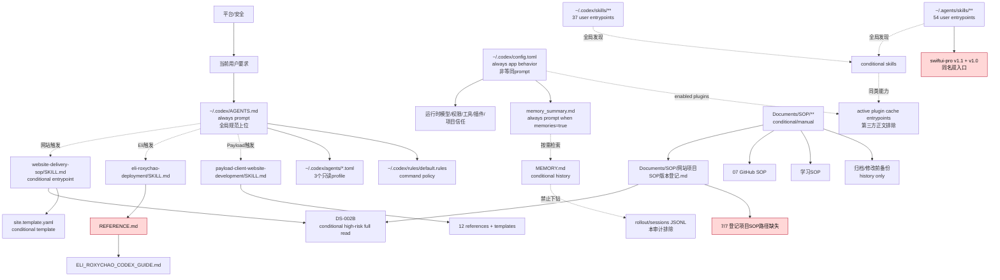

# 权威与引用关系图

审计时间：2026-08-09（Asia/Shanghai）。图只表示本次实时存在、可达的用户全局治理面；虚线表示条件加载或发现，红色节点表示存在断链/漂移。平台与当前用户要求是逻辑上位，不是本机文件。

## 权威角色与实际覆盖

| 层级 | 文件/面 | 加载频率 | 权威角色 | 允许覆盖 | 本次判断 |
|---|---|---|---|---|---|
| L0 | 平台/安全、当前用户要求 | always | 最高授权与任务边界 | 覆盖一切用户文件 | 本任务的只读、禁子agent、只写outputs均生效 |
| L1 | `~/.codex/AGENTS.md` | always prompt | 全局授权、安全、PMO、模型、生产、证据 | 覆盖项目规则、SOP、Skill、memory | 主体门禁完整，但标题仍称“候选”，且下位冲突很多 |
| L1-runtime | `config.toml`、rules、agent profiles、工具配置 | app/runtime | 决定默认模型、sandbox、插件、MCP、项目信任、命令策略 | 不得被当作当前用户授权；应与AGENTS目标一致 | 默认Sol、动态`@latest`、失效项目登记和广域trusted path需返工 |
| L2 | 用户级Skill入口 | conditional | 专项执行契约 | 只可补充/收紧L1 | diagnose、QA、并行子agent、安装指令等存在反向放宽 |
| L3 | Skill references/templates、DS-002B、Eli guide、SOP | conditional/reference | 详细步骤、模板、专项事实 | 不得建立第二上位权威 | Eli载体、工具链、Git、回滚存在冲突/漂移 |
| L4 | `memory_summary.md` | memories开启时always prompt | 稳定偏好摘要，非现行规则 | 不得覆盖L0-L3实时证据 | 混入日期项目史和旧组织清理，形成常驻污染 |
| L5 | `MEMORY.md`、归档/备份 | conditional/history | 历史线索与审计证据 | 只能触发实时复核 | 可保留；个别“current/durable routing”措辞需退役标记 |
| 排除 | plugin完整cache/runtime、sessions/logs/cache/tmp、项目业务文件 | N/A | 第三方版本体/运行记录/业务事实 | 仅当配置激活、同名碰撞或现行文件直引时定向核入口 | 未把“未审整个~/.codex”表述为完整 |

## 规范性可达边

| 来源 | 引用/发现 | 当前存在 | 关系 | 风险 |
|---|---|---:|---|---|
| AGENTS:37,51 | website Skill、DS-002B、site template | 是 | 全局摘要 → 网站专项全文 | DS的Eli旧段与现行例外冲突 |
| AGENTS:43 | Eli Skill及现行guide | 是 | Eli例外专项权威 | REFERENCE登记SHA不等于guide实际SHA；guide章节引用断裂 |
| AGENTS:51 | Payload Skill | 是 | CMS专项方法库 | 主要门禁一致；归档有22个完全重复文件，非现行权威 |
| SOP版本登记:18 | DS-002B | 是，SHA吻合 | SOP登记 → 全局网站权威 | 此边有效 |
| SOP版本登记:19-25 | 7个项目SOP | 否（7/7） | 当前版本组 → 项目delta | 活跃登记断链 |
| config:553-587 | 12个enabled plugins | cache入口存在 | runtime → 第三方入口 | 完整plugin正文排除；只盘点入口/同名/激活 |
| 两个用户Skill根 | 91个SKILL入口 | 是 | 全局发现 | `swiftui-pro`同名双版本；`pdf`与插件版有命名空间但选择策略不明 |
| memory_summary:21 | MEMORY检索 | 是 | 常驻摘要 → 条件历史 | 允许按需；rollout JSONL正文未读 |

## 断链与循环

- 本次机械解析发现 440 个本地 Markdown 链接中 48 个断链，分布于 17 个文件。高影响断链包括：SOP登记的 7 个项目入口、Eli guide 的错误 AGENTS 章节、Firecrawl 的 9 个缺失子Skill、prompt-videos 的 2 个缺失模型Skill，以及 planning-with-files 的 1 个缺失说明文件。
- 发现 6 组双向/循环链接，均位于同一Skill内部的导航或语言互链（Seedance、teach、impeccable、prototype等）。它们本身不构成语义冲突，但加载器不得据此递归全文读取。
- `AGENTS.override.md` 本次不存在；因此不存在当前遮蔽，但未来若新增，缺少“只可收紧”的独立加载验收仍是 `UNCERTAIN`。

## 最小充分载体判断

全局常驻层应只保留优先级、授权、秘密、PMO、模型唯一源、生产/迁移/删除/Git门禁、证据等级和条件路由。Eli的主机/来源IP/具体命令、DS阶段全文、Payload字段方法、PDF安装方法、项目状态与旧PMO路由应留在条件层；历史只应提供“去哪里查”和“必须实时复核”，不应在常驻摘要复述当前状态。
